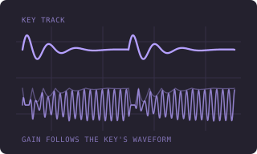
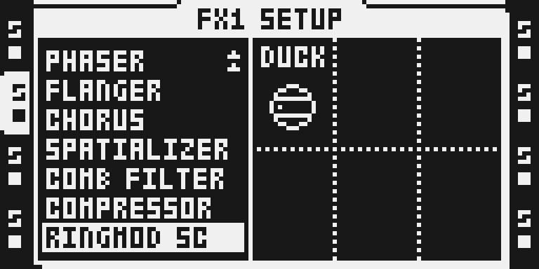
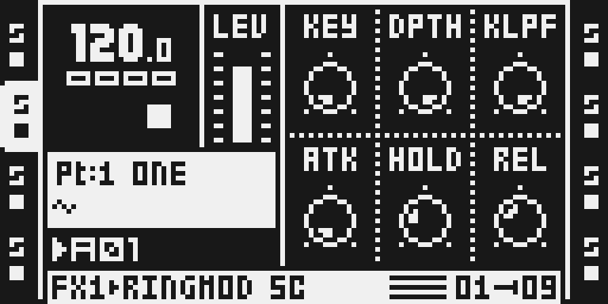
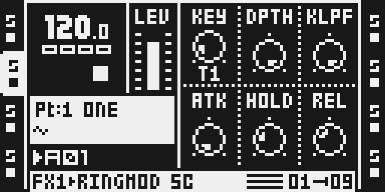

# Ringmod SC

Version: 0.1.0-experimental · author: @npp1993

## Overview

Ring mod sidechain. The track carrying RINGMOD SC has its gain driven by another track's audio (the KEY). In DUCK the key's level pulls the gain down: the gain follows the key's peak over the last 13-26 ms (HOLD sets this), so it holds through the kick's own zero crossings and steps back up as the kick decays, with no buzz. In RING the key multiplies the audio: a ring modulator whose carrier is another track.

The key is boosted four times. Measured under the emulator, a full-scale source on a key track at AMP VOL 64 (the default) reaches a quarter of full scale before its effects, so four times brings it exactly to full; at AMP VOL 127 it is four times hotter, and the duck holds at full depth until the kick has fallen by about 12 dB. The key's level comes from its AMP VOL and the sample, not from the track's LEVEL, which is after the effects.

The key comes from the Modwerk base's **key bus**: over USB, while RINGMOD SC is installed, the base publishes every track's audio as it enters FX1, on both DSP cores, and RINGMOD SC only reads it. It needs no other module and runs beside Sidechain Compressor, whose key tap the key bus is. A card image has no key bus, so there RINGMOD SC passes the audio untouched. This version has not run on hardware yet ([TESTING.md](TESTING.md)).

## Controls

| Control | Default | Range | Behaviour |
| --- | --- | --- | --- |
| KEY | OFF | OFF, T1-T8 | The track whose audio drives the gain. OFF leaves the track untouched. |
| DPTH | 127 | 0-127 | How far the key moves the gain; 0 leaves the track untouched. |
| KLPF | 127 | 0-127 | Low-pass on the key: 14 Hz at 0, an octave every 14 steps, open at 127. About 20-50 covers a kick's body (40-200 Hz). |
| ATK | 0 | 0-127 | DUCK: how slowly the gain falls when the key rises; 0 is at once. Unused in RING, where it is drawn as "-". |
| HOLD | 34 | 0-127 | DUCK: how long the duck holds after each peak of the key, one to two windows of 0.7 ms at 0, 13 ms at 34, 24 ms at 64 and 47 ms at 127. Keep it above half a cycle of the kick (about 13 ms for 40 Hz) or the duck buzzes; longer gives a fuller pump. Unused in RING, where it is drawn as "-". |
| REL | 45 | 0-127 | DUCK: how slowly the gain recovers once the key's peak drops; 45 is about 9 ms. Unused in RING, where it is drawn as "-". |
| MODE | DUCK | DUCK, RING | SETUP page. DUCK: the key's level pulls the gain down. RING: the key multiplies the audio. |

The main page holds KEY, DPTH and KLPF on encoders A-C and ATK, HOLD and REL on D-F; MODE is on the SETUP page, and three main-page names follow it. DPTH 0 or KEY OFF returns the input bit for bit. KEY steps like a stock select, about three detents a track. On the first visit to the main page after choosing the effect it may still move one track a detent, until the page is entered again (seen on card images under the emulator; not checked on the USB base). The track names are stored with a space on each side (" T1 "), which draws centred where "T1" would.

ATK and REL share one scale: 0 is at once, 1 is about 0.7 ms, and the time doubles every 11.6 steps up to about 1.3 s at 127.

| Knob | 0 | 1 | 16 | 32 | 48 | 64 | 80 | 96 | 112 | 127 |
| --- | --- | --- | --- | --- | --- | --- | --- | --- | --- | --- |
| Time | at once | 0.7 ms | 1.8 ms | 4.6 ms | 12 ms | 31 ms | 83 ms | 210 ms | 540 ms | 1.3 s |

These come from the formula; ATK 32 measured 203 samples (4.6 ms) in the render gate. REL counts from the moment the key's peak over the HOLD window drops, so even REL 0 does not buzz at the default HOLD; raise it for a slower pump.

| KLPF | 0 | 10 | 20 | 30 | 40 | 50 | 60 | 80 | 100 | 120 | 127 |
| --- | --- | --- | --- | --- | --- | --- | --- | --- | --- | --- | --- |
| Cutoff | 14 Hz | 24 Hz | 41 Hz | 62 Hz | 104 Hz | 181 Hz | 280 Hz | 750 Hz | 2.3 kHz | 9.7 kHz | open |

## Usage

Install RINGMOD SC on the Octatrack over USB (a module set on the Modwerk beta base with the key bus). Select an audio track, hold FUNC and press FX1 or FX2 for SETUP, turn LEVEL to RINGMOD SC and press YES. Press the FX button for the main page. Turn encoder A until KEY reads the track to follow; DPTH (encoder B) sets how deep the gain moves. These steps follow the emulator captures below, not a unit.

For the cleanest duck put the key on a track the instrument handles before the ducked one on the same half (T1-T4 or T5-T8, a lower number): the key is then exact. A key on a higher-numbered track of the same half is heard 16 samples late, and a key on the other half 32 samples (0.7 ms) late. These are the key bus's figures (measured on an MKII for Sidechain Compressor), not yet measured with RINGMOD SC. The key is taken before the key track's own effects.

## Quick tutorial

1. Put a kick on T1 and a sustained bass on T2. Select T2, hold FUNC and press FX1, turn LEVEL to RINGMOD SC and press YES, then press FX1.
2. Turn encoder A until KEY reads T1. The bass dips with every kick and comes back as the kick decays; DPTH (encoder B) sets how deep.
3. Raise REL (encoder F) for a slower recovery, HOLD (encoder E) for a longer pump and ATK (encoder D) to soften the onset. Turn KLPF (encoder C) down to about 30-50 so only the kick's body drives the duck, not its click or other sounds on the key track.
4. Turn KEY back to OFF, or DPTH to 0, to hear the bass untouched. Choose NONE in SETUP to remove the effect.

## Compatibility and limitations

- Original OS 1.40C. FX1 and FX2 of any audio track, several at once; its own effect id (0x06), so it displaces no stock effect.
- **Over USB only, on a Modwerk base with the key bus** (the loader's ABI 9; the package requires the key bus and declares its reads of the bus and the window). A card image has no key bus, so the configurator does not build card firmware with it: a set that includes it syncs over USB, and its card download asks you to take RINGMOD SC out (the site's rule for any module whose package needs a base feature). Should a card image carry it anyway, RINGMOD SC keeps its depth at 0 there and passes the audio untouched.
- **The key bus's cost counts toward RINGMOD SC.** While it is installed the base's tap copies every track's audio on every block on both cores, even with no instance on a track: 41 executed instructions a sample a core by a count of its source, charged at 7/4 (72) until it is timed on a unit. Installed beside Sidechain Compressor, which holds the bus too, RINGMOD SC still pays for it.
- Runs beside Sidechain Compressor: both read the key bus, and RINGMOD SC writes nothing outside its own state. Installing or reinstalling Sidechain Compressor while RINGMOD SC is live re-zeroes the bus once: up to about a block of silent key.
- A MODE or KEY change fades the effect out, clears the key's state and fades back in, about 1 ms in all, so a KEY parameter lock shorter than that is not heard.
- **Declared conflict with Analog BD.** It is carried over from the card builder's rule: Analog BD admits only the effects on its companion list, and RINGMOD SC is not on it. Over USB no resource clash is known, but the declaration applies to every build, so the configurator never offers both. Whether to keep it is the owner's call.
- A project that selects RINGMOD SC on a base without it gets no effect in that slot.
- 270 words of DSP program per core, 16 words of state per instance (19 reserved), no delay buffer; the key bus's memory (Y $800-$9FF on each core, the last $202 words of each core's half of the shared window) is the base's.
- Not tested on hardware: everything about this version. Parameter locks and LFOs were run in the emulator on the earlier build only; scenes, project save, Part reload and a power cycle are untested. An LFO at full depth on KEY takes it past T8, which reads as OFF.

## Tests and measurements

[TESTING.md](TESTING.md) has the commands and every result: the render gate against a reference model, a sample-for-sample comparison with the previous own-tap build, a 30-second stress render of eight instances, the benchmark against stock and the stress project for the performance record ([evidence/performance.json](evidence/performance.json)), the USB package's checks, and the earlier build's emulator and card-image history.

## Authorship and licences

Original code, tests and documentation by Nathaniel Pawelczyk (@npp1993), MIT ([LICENSE](LICENSE)). It reads the Modwerk base's key bus, which is Sidechain Compressor's key tap and bus layout, by Zac Kyoti (@Zac-Kyoti) and the OT Kyoti FW contributors (MIT), made a base feature; none of that code is in this module. No Elektron firmware, extracted routine or table is included.

## Screens and audio

Unedited MKII framebuffer captures from the headless emulator, taken on a private card image that carried the earlier own-tap build of this version, whose pages are the same (KEY then read "T1" without the padding spaces). [Capture provenance](media/capture.json) has the panel plan and the image and emulator hashes; [media rights](media/LICENSE.md) reserves the underlying Elektron rights. They show the pages, not audio; no audio is included.

The thumbnail above is an illustration, not OT UI evidence.
